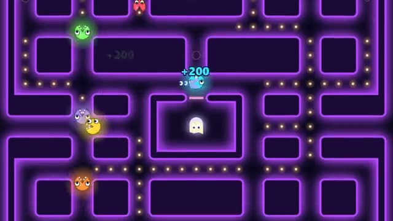

# Maze Munch

One neon maze, everyone munching. Glow, then chomp. A multiplayer starter game from [Multiplayer Agent](https://multiplayeragent.com): 2D, versus, 2–8 players, with bots that fill empty seats.

## How it plays

Munch dots for points while the spooks hunt you. Eat a glowing orb and for a few seconds you can chomp other players and spooks; in the last 20 seconds a chomp knocks you out. Most points at the buzzer wins.

**Controls:** Arrow keys or WASD to move; swipe or the on-screen pad on touch.

## Make it yours in the Game Builder

Open the [Game Builder](https://multiplayeragent.com), choose **Start from a starter game** and pick Maze Munch. It opens as version 1 in your studio, ready to play and publish. Then ask for changes, for example:

- Add a cherry that gives 500 points and appears every 20 seconds
- Make the maze bigger, with a second tunnel
- Make it teams: red chompers against blue

## Run it yourself

1. Get a free publishable key (`pk_…`) at [multiplayeragent.com](https://multiplayeragent.com).
2. In `index.html`, put it in place of `pk_REPLACE_ME` in the `MP_CONNECT` block.
3. Open `index.html` in a browser. No build step and no server needed.

Without a key it still runs, offline against bots.

## How it is built

- One `index.html`. The comment at the top of the script maps the code and explains the multiplayer. The maze is a text map in the `MAZE` section: edit it to make your own.
- **Leaderboard:** Each player's best round score, shown on the results card.
- **Host-run rules:** The host's browser keeps the dots and orbs and decides who chomped whom; if it leaves, the next player takes over.
- **Host-run rounds:** Rounds, the clock and the final 20 seconds are timestamps in shared state, so a new host carries on.
- **Bots:** Bot chompers fill the maze until enough people join, and spooks roam it.
- **Live sync:** Every chomper moves itself and everyone sees it at once.
- `?attract` runs it offline with bots only. The preview video is recorded from it.

## License

MIT.
